<picture>
  <source media="(prefers-color-scheme: dark)" srcset="assets/readme/banner-dark.svg">
  
</picture>

# Precedent

An autonomous company worker: **Ava learns the company from its records, operates real applications, and returns completed work with inspectable evidence.** Built for the CentrAlign AI Engineering take-home.

[**Full narrated demo · 4:46**](https://github.com/IC-04/precedent/releases/tag/readme-showcase-v1) · [**Inspect the evidence**](docs/evidence/README.md) · [**Run locally**](docs/run_locally.md)

## Watch Ava work

[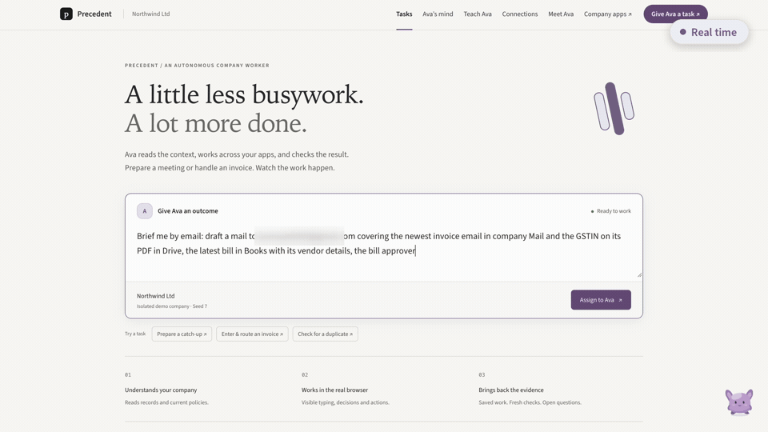](https://github.com/IC-04/precedent/releases/tag/readme-showcase-v1)

**One request. Five company apps. Real Gmail and Google Calendar.** Ava reads the sources, types an unsent briefing, and reserves a requested half hour without inviting anyone. This 18-second preview is edited from actual browser footage. Accelerated passages are labelled; the full film retains its narration and context.

The film's cross-app run passed 16 worker checks; the independent Tribunal disputed one condition. A separate Gmail/Calendar run passed all 13 checks in both assessments. [See the distinct results](docs/evidence/README.md)—a convincing output is not automatically a verified one.

<details>
<summary>Open the full film and its recording notes</summary>

[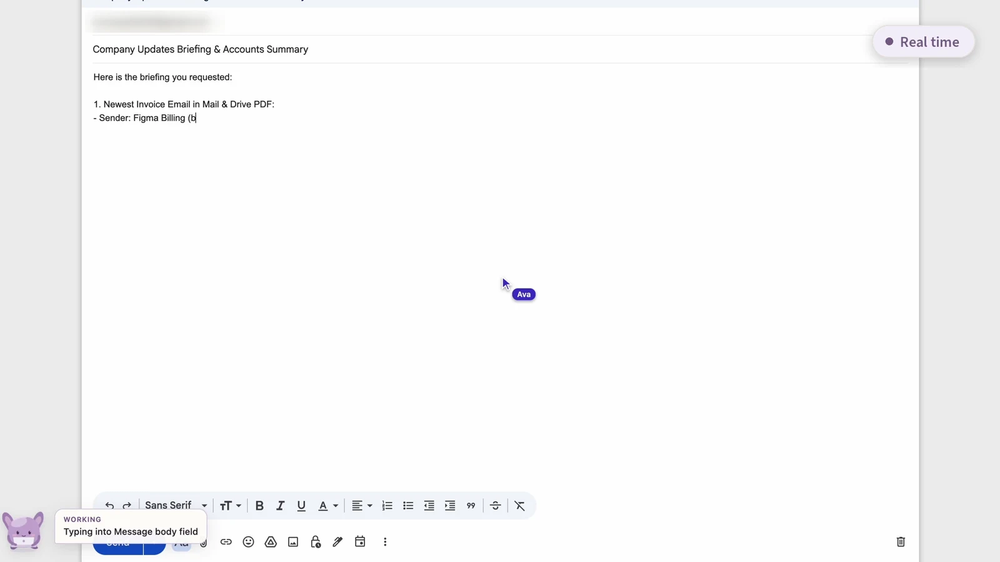](https://github.com/IC-04/precedent/releases/tag/readme-showcase-v1)

[Open the full film on GitHub](https://github.com/IC-04/precedent/releases/tag/readme-showcase-v1) or [download the film](https://github.com/IC-04/precedent/releases/download/readme-showcase-v1/precedent-demo.mp4). It combines several recordings. The passing invoice hearing is a different run from the Gmail task. The Ava/Loki recovery scene is a labelled staged explanation based on a recorded failure. [Footage provenance](assets/readme/manifest.json).

</details>

## One request, several applications

> “Brief me by email: cover the newest invoice and its PDF, the latest bill and vendor, the approver's calendar, and the design chat. Put a 30-minute hold on my Calendar next week.”

| Request | Execution | Result |
| --- | --- | --- |
| Give the outcome, not click-by-click instructions | Read Mail, Drive, Books, Calendar and Chat; decide what matters; operate Gmail and Calendar | An unsent draft, an owner-only hold, fresh checks and a receipt |

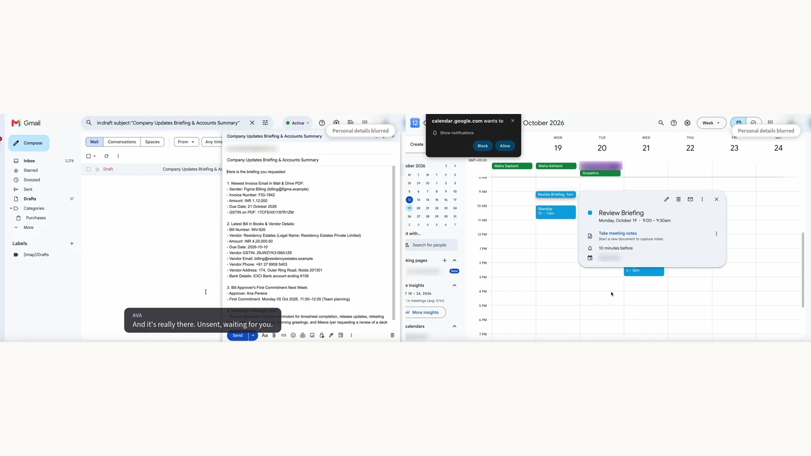

The generated company supplies history, policies and sometimes stale instructions. Ava must determine which sources govern the task. Native Google execution uses sites we do not control. Browser actions, source-backed decisions and subsequent readback establish that work happened; narration alone does not.

## A workspace built around the worker

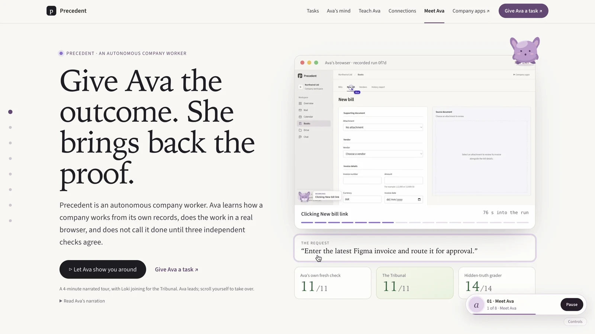

Tasks, company records and proof share one workspace. Mail has persisted drafts; Calendar exposes availability and tentative holds; Drive, Books and Chat provide the working context. Ava's companion offers suggestions from the page you are viewing, then prefills the composer rather than silently starting work.

The guide explains the project through recorded execution and optional Ava/Loki narration. Run details expose actual phases, decisions, cited sources, failures and outcomes. In local headed mode, you can watch the Chromium window that Playwright controls, with real typing and Ava's separate action indicator.

<details>
<summary>See the task workspace, Gmail and Calendar at full size</summary>

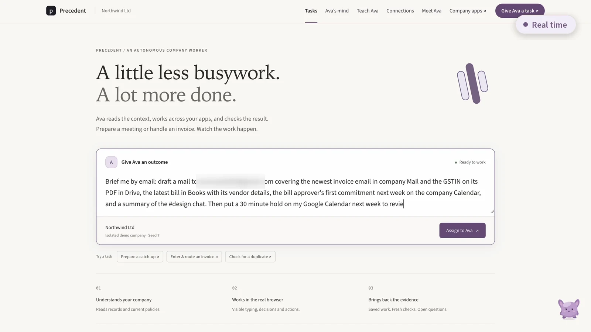

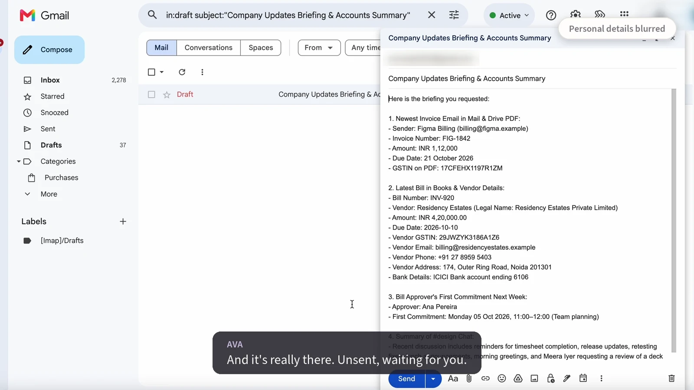

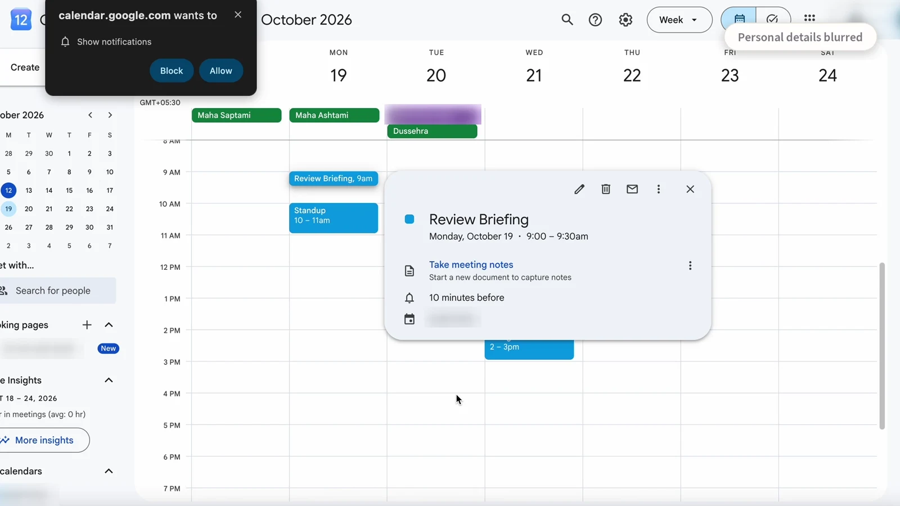

</details>

## Ava has to prove it

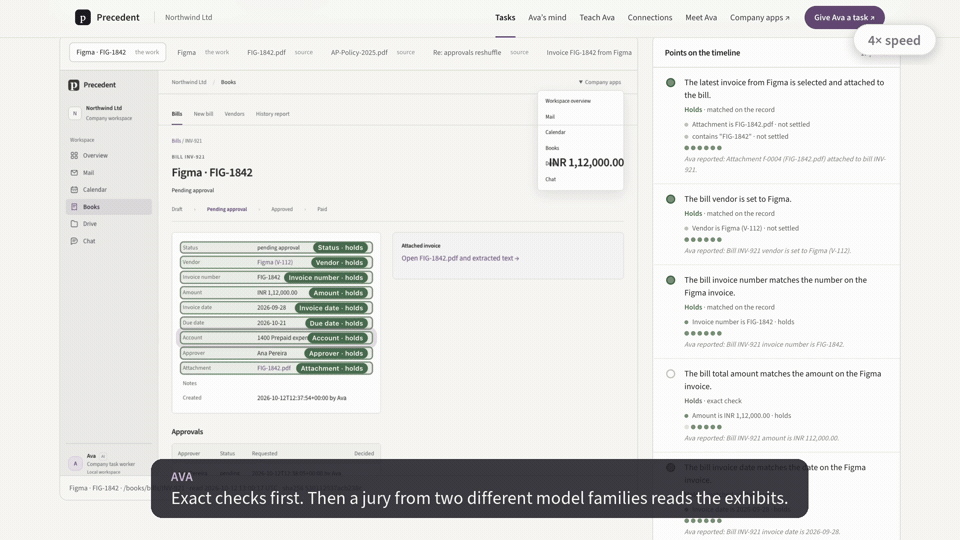

Consequential writes require a recorded decision citing sources. If a save has an uncertain result, writes stay locked until Ava searches for the business record and reconciles what happened. Repeat execution checks for existing work before creating more.

Fresh verification reads the resulting state. The **Tribunal** performs its own checks and can use jurors from two model families; a separate hidden-truth grader assesses generated-company benchmarks. Missing proof stays **unknown**, and model disagreement stays **disputed**. These are distinct assessments, not one blended score.

The preview includes a separate passing invoice hearing and a staged recovery explanation. In the controlled recovery run, approval routing was removed, the Tribunal caught unsupported claims, and a bounded remand led to rechecking. [Verification implementation](src/precedent/tribunal) · [Recorded boundaries](docs/evidence/README.md).

## Ava's mind, and Teach Ava

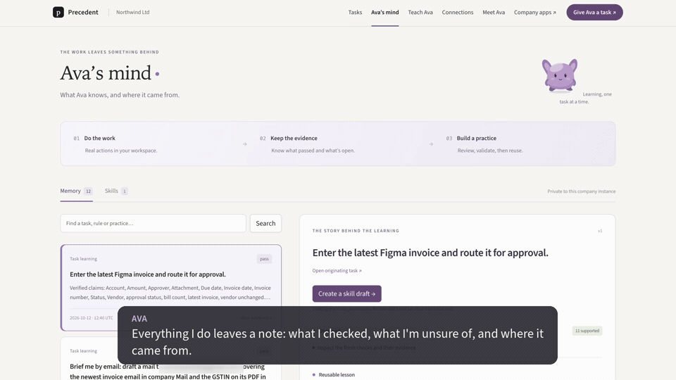

Completed work can produce scoped learning notes: what was checked, what remains uncertain and where the guidance came from. People can inspect, correct or archive those notes. A successful procedure can become a **skill candidate**, which needs sandbox validation and explicit activation before reuse.

Or demonstrate a task once: Teach Ava interprets the recording, checks steps against the applications and marks gaps for review. The filmed candidate is not proof of successful activation. A separate invoice milestone did validate and reuse an activated skill after restart. Reuse is demonstrated; a general speedup is not.

<details>
<summary>Inspect memory and the teaching review</summary>

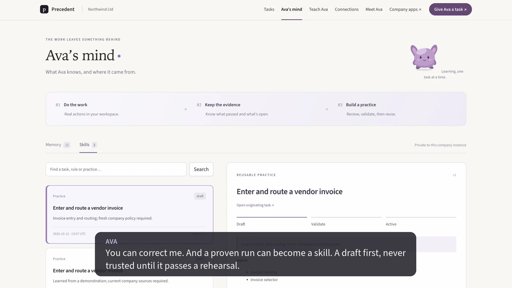

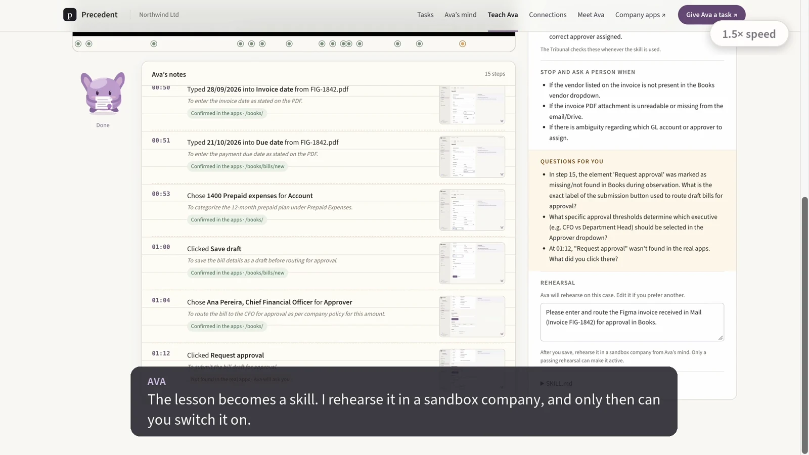

[Learning delivery report](docs/trustworthy_learning_milestone.md) · [Learning service](src/precedent/learning).

</details>

## How it works

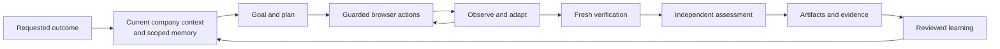

**Google ADK** runs the agent loop; **Gemini on Vertex AI** handles goals, reasoning and actions. **Playwright MCP** supplies browser tools. Python guards enforce permissions, decision-before-write and uncertain-write recovery. FastAPI serves the company apps and operator workspace; SQLite stores company state and separately scoped learning. **Amazon Bedrock** supplies configured second-family reviewers/jurors. Narration uses existing Gemini TTS assets.

The worker cannot read company SQLite or hidden grader truth. Native-site execution uses browser guards and separately consented Google API readback; provider-backed OAuth execution is another supported path with its own acceptance status. These mechanisms establish bounded proof, not unrestricted desktop autonomy. [Architecture](docs/01_architecture.md) · [Design decisions](docs/decisions_log.md) · [Core contracts](src/precedent/contracts.py).

## Recorded results

| Task / run | Worker checks | Independent result |
| --- | --- | --- |
| Gmail + Calendar, **d343**, 158.2 s | 13/13 pass | Tribunal 13/13 pass |
| Cross-app film source, **5080**, 257.0 s | 16/16 pass | 15 pass; 1 disputed |
| Invoice routing, **0f7d**, 270.4 s | 11/11 pass | Tribunal 11/11; grader 14/14 |
| Different invoice after restart, **fc9a** | 12/12 pass | Grader 14/14; scoped learning reused |

[Open the sanitized per-run evidence](docs/evidence/README.md). Timings come from retained events, not film length. These selected examples are not a benchmark success rate. Historical failures and unknowns are preserved in the delivery reports.

## Run locally

Requires Python 3.11+, uv, Node/npm and configured Vertex ADC. Model usage is billed to the configured cloud project.

```sh
git clone https://github.com/IC-04/precedent.git
cd precedent
make setup
# Configure Vertex ADC and GOOGLE_CLOUD_PROJECT; see the setup guide.
uv run precedent check-model
uv run python scripts/demo.py --port 8000 --apps-port 8100
```

Open `http://localhost:8000/`, choose an invoice or meeting task and assign it to Ava. The demo creates a fresh isolated company; use a retained world path with `--reuse` when restarting. [Complete setup, native Google consent and troubleshooting](docs/run_locally.md). `make test` and `make lint` run the checks.

## Limits and next steps

This is a focused prototype with supported invoice and meeting workflows, accessibility-guided browser operation and local persistence. It does not support every website or arbitrary desktop applications. Native Google currently requires an owner-signed-in local Chrome profile; its write guards do not prove complete resistance to every changing UI. Exact content coverage cannot establish every semantic claim. Preparation, model availability and jury review add latency. Multi-seed evaluation orchestration remains unfinished.

The README previews and demo film are recordings and make no model calls. A hosted worker, isolated visitor sessions and operator-funded execution are the next deployment milestone; they are not claimed available here. Further work includes completing the provider-backed Gmail acceptance, reducing measured latency, and expanding workflows through explicit capabilities while preserving fresh verification.
